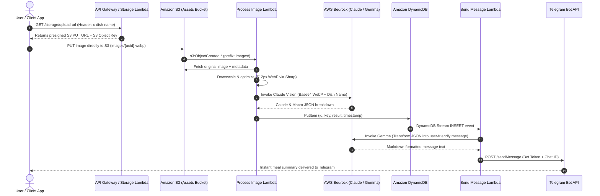

# CalorieLens Backend

[](https://nodejs.org)
[](https://www.serverless.com)
[](https://aws.amazon.com/bedrock/)
[](https://aws.amazon.com/dynamodb/)
[](https://aws.amazon.com/s3/)
[](https://opensource.org/licenses/ISC)

> An event-driven, serverless backend powered by AWS Bedrock multimodal AI that processes meal images, estimates nutritional calories, and delivers conversational meal summaries to Telegram.

---

## Table of Contents

- [Overview](#overview)
- [Why CalorieLens Backend](#why-calorielens-backend)
- [System Architecture](#system-architecture)
- [Repository Structure](#repository-structure)
- [Prerequisites](#prerequisites)
- [Configuration & Environment](#configuration--environment)
- [Getting Started](#getting-started)
  - [1. Clone and Install](#1-clone-and-install)
  - [2. Configure AWS SSM Parameters](#2-configure-aws-ssm-parameters)
  - [3. Local Development](#3-local-development)
  - [4. Deployment](#4-deployment)
- [API Reference](#api-reference)
- [Where to Get Help](#where-to-get-help)
- [Contributing & Maintainers](#contributing--maintainers)
- [License](#license)

---

## Overview

**CalorieLens Backend** is a cloud-native microservice architecture designed to automate dietary logging. Instead of requiring users to manually input ingredients and portion sizes, the system ingests food photography, extracts meal context, and produces structured nutritional estimates.

The service decouples file upload, computer vision processing, and user alerting using event-driven AWS primitives:

1. **Presigned Uploads**: Clients request secure, short-lived S3 URLs directly via an API Gateway HTTP endpoint.
2. **Vision Analysis (S3 Trigger)**: Uploading an image triggers a Lambda function that compresses the image with [Sharp](https://sharp.pixelplumbing.com/) and submits it alongside the dish title to Anthropic Claude on [AWS Bedrock](https://aws.amazon.com/bedrock/).
3. **Stream Notifications (DynamoDB Streams)**: Successfully parsed nutritional metrics are saved to DynamoDB. The change stream invokes a messaging Lambda that formats the output with Google Gemma on AWS Bedrock and sends a formatted message to Telegram.

---

## Why CalorieLens Backend

- **100% Serverless & Zero Idle Cost**: Built on AWS Lambda, DynamoDB Pay-Per-Request, API Gateway HTTP API, and S3 lifecycle storage.
- **Two-Tier Generative AI Architecture**:
  - **Vision Model (Claude)**: Analyzes visual features (portion size, ingredients, dish composition) with high accuracy.
  - **Conversational Model (Gemma 3 12B IT)**: Re-synthesizes technical nutritional JSON into encouraging, human-friendly Telegram messages.
- **Asynchronous & Decoupled**: The client experience never blocks on model inference. Clients upload directly to S3, while backend processing occurs asynchronously via event notifications.
- **Intelligent Asset Lifecycles**: Images are downscaled to 512px WebP before inference to conserve bandwidth. S3 lifecycles transition raw uploads to `GLACIER_IR` after 10 days and automatically delete them after 100 days.
- **Centralized Parameter Management**: API keys, bot tokens, and system prompts are fetched dynamically via AWS Systems Manager (SSM) Parameter Store.

---

## System Architecture



---

## Repository Structure

```text
calorie-lens-backend/
├── .github/
│   └── workflows/
│       └── deploy-serverless.yaml   # GitHub Actions CI/CD deployment workflow
├── aws/
│   ├── iam.yaml                     # IAM role definitions (Bedrock, DynamoDB, S3, SSM)
│   └── resources.yaml               # CloudFormation resources (DynamoDB Table, S3 Bucket)
├── core/
│   ├── bedrock_client.js            # Bedrock client for Claude vision & Gemma text
│   ├── cloudwatch_logs.js           # Structured JSON logger for CloudWatch
│   ├── dynamo_client.js             # DynamoDB DocumentClient put operations
│   ├── parameter_store.js           # SSM Parameter Store integration
│   ├── s3_client.js                 # Presigned URL generation & object retrieval
│   └── secrets_manager.js           # AWS Secrets Manager integration
├── src/
│   ├── processImage/                # S3-triggered image processor & AI extractor
│   │   ├── handler.js
│   │   └── service.js
│   ├── sendMessage/                 # DynamoDB Stream-triggered Telegram notifier
│   │   ├── handler.js
│   │   └── service.js
│   └── storage/                     # Express HTTP API for presigned URLs
│       ├── handler.js
│       └── routes.js
├── utils/
│   ├── clean_json.js                # JSON markdown stripper and parser
│   ├── create_app.js                # Express app factory with serverless-http
│   └── optimize_image.js            # Sharp WebP compression pipeline
├── eslint.config.js                 # ESLint flat configuration
├── package.json                     # Node.js 24 dependencies and scripts
└── serverless.yaml                  # Serverless Framework configuration
```

---

## Prerequisites

Before running or deploying the service, ensure you have:

- **Node.js**: `v24.x` or higher
- **npm**: `v10.x` or higher
- **AWS Account & CLI**: An active AWS account with the [AWS CLI](https://aws.amazon.com/cli/) configured (`aws configure`)
- **AWS Region**: `ap-south-1` (default configured region)
- **AWS Bedrock Model Access**: Access granted in your AWS console for:
  - Anthropic Claude multimodal models (or the model referenced in `/ai/claude-model-arn`)
  - `google.gemma-3-12b-it`
- **Telegram Bot**: A Telegram bot token created via [@BotFather](https://t.me/botfather) and your target `chat_id`

---

## Configuration & Environment

### 1. Local Environment Variables

Create a `.env` file in the project root to set the AWS CLI profile to use:

```bash
AWS_PROFILE=your-aws-profile-name
```

### 2. AWS SSM Parameter Store Requirements

The backend retrieves dynamic settings and secrets from AWS Systems Manager Parameter Store. Add the following parameters in AWS region `ap-south-1`:

| Parameter Name                       | Type           | Description                                             | Example                                                        |
| :----------------------------------- | :------------- | :------------------------------------------------------ | :------------------------------------------------------------- |
| `/calorie-lens/telegram/bot-token`   | `SecureString` | Telegram Bot authentication token                       | `123456789:ABCdefGhIJKlmNoPQRsTUVwxyZ`                         |
| `/calorie-lens/telegram/chat-id`     | `String`       | Target Telegram Chat ID                                 | `987654321`                                                    |
| `/ai/claude-model-arn`               | `String`       | Bedrock Model ID or inference profile ARN               | `anthropic.claude-3-sonnet-20240229-v1:0`                      |
| `/calorie-lens/lambda/system-prompt` | `String`       | Vision extraction prompt instructing nutritional schema | `Return a JSON breakdown of calories and macros for the dish.` |

You can quickly create these using the AWS CLI:

```bash
aws ssm put-parameter --name "/calorie-lens/telegram/bot-token" --value "YOUR_TELEGRAM_BOT_TOKEN" --type "SecureString" --region ap-south-1
aws ssm put-parameter --name "/calorie-lens/telegram/chat-id" --value "YOUR_TELEGRAM_CHAT_ID" --type "String" --region ap-south-1
aws ssm put-parameter --name "/ai/claude-model-arn" --value "YOUR_BEDROCK_CLAUDE_ARN" --type "String" --region ap-south-1
aws ssm put-parameter --name "/calorie-lens/lambda/system-prompt" --value "Analyze the dish in the image and return a JSON object with calories, protein, fat, and carbs." --type "String" --region ap-south-1
```

---

## Getting Started

### 1. Clone and Install

Clone the repository and install all dependencies:

```bash
git clone https://github.com/masanthimanshu/calorie-lens-backend.git
cd calorie-lens-backend
npm install
```

### 2. Configure AWS SSM Parameters

Ensure all parameters listed in [Configuration & Environment](#configuration--environment) are set up in your AWS account.

### 3. Local Development

Start the local API Gateway emulator using `serverless-offline`:

```bash
npm run dev
```

The HTTP endpoints will be reachable at `http://localhost:3000`.

> **Note**: `serverless-offline` simulates the HTTP API (`storageApi`). S3 uploads and DynamoDB Streams trigger directly in AWS or require local mocking plugins.

### 4. Deployment

#### Manual Deployment

To provision all AWS resources (S3 bucket, DynamoDB table with stream, IAM policies, and Lambda functions) and deploy the code:

```bash
npm run deploy
```

#### Automated Deployment (GitHub Actions)

A CI/CD pipeline is provided in [.github/workflows/deploy-serverless.yaml](.github/workflows/deploy-serverless.yaml). It automatically deploys changes pushed to the `main` branch.

To enable GitHub Actions deployment, configure the following secrets in your repository (**Settings > Secrets and variables > Actions**):

- `AWS_ACCESS_KEY_ID`
- `AWS_SECRET_ACCESS_KEY`
- `SERVERLESS_ACCESS_KEY`

---

## API Reference

### Storage Service

The Storage API handles image upload initialization.

#### 1. Health Check

```http
GET /storage/health
```

**Response (`200 OK`)**:

```json
{
  "status": "Storage API route is working!"
}
```

#### 2. Request Image Upload URL

Generates a time-limited (300 seconds) S3 presigned URL for uploading a food image.

```http
GET /storage/upload-url
```

**Headers**:

- `x-dish-name` _(string, optional)_: The name of the meal or food item being photographed.

**Example Request**:

```bash
curl -X GET "https://<api-id>.execute-api.ap-south-1.amazonaws.com/storage/upload-url" \
  -H "x-dish-name: Grilled Salmon with Asparagus"
```

**Response (`200 OK`)**:

```json
{
  "uploadUrl": "https://calorie-lens-assets-bucket.s3.ap-south-1.amazonaws.com/images/550e8400-e29b-41d4-a716-446655440000.webp?AWSAccessKeyId=...",
  "key": "images/550e8400-e29b-41d4-a716-446655440000.webp"
}
```

#### 3. Upload Image to S3

Upload your image directly to the generated `uploadUrl` via an HTTP `PUT` request:

```bash
curl -X PUT "<uploadUrl>" \
  -H "Content-Type: image/webp" \
  --data-binary "@/path/to/food-photo.webp"
```

Once uploaded, the `processImage` function executes automatically.

---

## Where to Get Help

- **Issues**: Open a bug report or feature request on [GitHub Issues](https://github.com/masanthimanshu/calorie-lens-backend/issues).
- **Serverless Framework Docs**: Refer to the [Serverless v4 Documentation](https://www.serverless.com/framework/docs).
- **AWS Bedrock Documentation**: Learn more about foundation models on [AWS Bedrock Docs](https://docs.aws.amazon.com/bedrock/).
- **AWS SDK for JavaScript v3**: Review the [AWS SDK v3 Reference Guide](https://docs.aws.amazon.com/AWSJavaScriptSDK/v3/latest/).

---

## Contributing & Maintainers

### Maintainer

- **Himanshu Masanth** ([@masanthimanshu](https://github.com/masanthimanshu))

### Contributing

Contributions, enhancements, and suggestions are welcome!

1. Fork the repository
2. Create a descriptive feature branch:
   ```bash
   git checkout -b feature/my-new-feature
   ```
3. Ensure your changes pass code linting:
   ```bash
   npx eslint .
   ```
4. Commit your changes:
   ```bash
   git commit -m "feat: add support for portion size estimation"
   ```
5. Push to the branch and open a Pull Request against `main`.

---

## License

This project is licensed under the [ISC License](https://opensource.org/licenses/ISC).
