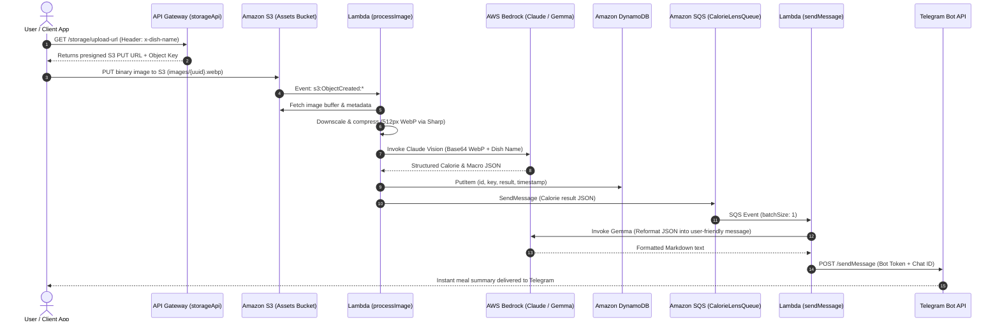

# CalorieLens Backend

[](https://nodejs.org)
[](https://www.serverless.com)
[](https://aws.amazon.com/bedrock/)
[](https://aws.amazon.com/s3/)
[](https://aws.amazon.com/dynamodb/)
[](https://aws.amazon.com/sqs/)
[](https://github.com/masanthimanshu/calorie-lens-backend/actions/workflows/check-code.yaml)
[](https://opensource.org/licenses/ISC)

> An event-driven, serverless backend powered by AWS Bedrock multimodal AI that analyzes meal photos, estimates calories and macros, and delivers friendly nutritional breakdowns to Telegram via Amazon SQS.

---

## Table of Contents

- [What the Project Does](#what-the-project-does)
- [Why the Project is Useful](#why-the-project-is-useful)
- [System Architecture](#system-architecture)
- [Repository Structure](#repository-structure)
- [How Users Can Get Started](#how-users-can-get-started)
  - [Prerequisites](#prerequisites)
  - [1. Clone and Install](#1-clone-and-install)
  - [2. Environment Configuration](#2-environment-configuration)
  - [3. Configure AWS SSM Parameters](#3-configure-aws-ssm-parameters)
  - [4. Local Development](#4-local-development)
  - [5. Code Quality](#5-code-quality)
  - [6. Deployment](#6-deployment)
- [Usage & API Flow](#usage--api-flow)
  - [Health Check](#health-check)
  - [Request Upload Presigned URL](#request-upload-presigned-url)
  - [Upload Meal Image](#upload-meal-image)
- [Where Users Can Get Help](#where-users-can-get-help)
- [Who Maintains and Contributes](#who-maintains-and-contributes)
- [License](#license)

---

## What the Project Does

**CalorieLens Backend** automates dietary logging by replacing manual nutrition tracking with an AI-powered visual pipeline. Rather than typing dish ingredients and measuring portions by hand, users simply upload a meal photo.

The backend processes the request through a completely decoupled, serverless pipeline:

1. **Presigned Uploads**: API Gateway generates time-limited S3 upload URLs with custom dish metadata.
2. **Computer Vision Inference**: S3 object creation triggers a Lambda worker that optimizes the image using Sharp and sends it to Anthropic Claude on AWS Bedrock for calorie, macro, and ingredient estimation.
3. **Data Persistence**: Calorie analysis results and meal metadata are stored in Amazon DynamoDB.
4. **Resilient Message Queuing**: The analysis payload is enqueued into Amazon SQS with an automated Dead Letter Queue (DLQ) redrive policy.
5. **Conversational Synthesis & Alerting**: An SQS-triggered Lambda worker uses Google Gemma (`google.gemma-3-12b-it`) on AWS Bedrock to transform technical nutritional JSON into an encouraging, readable summary and sends it directly to the user's Telegram chat.

---

## Why the Project is Useful

- **100% Serverless & Zero Idle Cost**: Built entirely on AWS Lambda, Amazon S3, Amazon DynamoDB (Pay-Per-Request), Amazon SQS, and API Gateway HTTP API.
- **Dual-Model Generative AI Pipeline**:
  - **Vision Extractor (Anthropic Claude via Bedrock)**: Extracts portion estimates, macronutrients (protein, carbs, fats), and total calories from meal photos and dish names.
  - **Conversational Formatter (Google Gemma 3 12B IT via Bedrock)**: Synthesizes structured JSON into user-friendly, supportive Telegram notifications.
- **Decoupled & Resilient with Amazon SQS**: Offloads notification dispatching to Amazon SQS (`CalorieLensQueue`) backed by a Dead Letter Queue (`CalorieLensDeadLetterQueue`, 3 retries). This protects against rate limits, isolates failures, and prevents slow messaging calls from holding up the image processing pipeline.
- **Zero API Gateway Payload Bottlenecks**: Clients upload meal images directly to S3 via secure, short-lived presigned URLs, bypassing API Gateway file size limits and execution timeouts.
- **Optimized Asset Pipeline**: Raw images are resized to 512px WebP (quality 75) using Sharp before base64 encoding and Bedrock inference, reducing latency and token bandwidth.
- **Automated S3 Lifecycle Management**: Assets transition to `GLACIER_IR` after 10 days and expire after 100 days, keeping storage costs minimal.
- **Centralized Parameter Management**: System prompts, Bedrock model ARNs, and Telegram bot secrets are managed dynamically via AWS Systems Manager (SSM) Parameter Store.

---

## System Architecture



---

## Repository Structure

```text
calorie-lens-backend/
├── .github/
│   └── workflows/
│       ├── check-code.yaml          # Linting and formatting CI workflow
│       └── deploy-serverless.yaml   # GitHub Actions CI/CD deployment workflow
├── aws/
│   ├── iam.yaml                     # Least-privilege IAM policies (Bedrock, SSM, S3, DDB, SQS)
│   └── resources.yaml               # CloudFormation templates (DynamoDB, S3 Bucket, SQS + DLQ)
├── core/
│   ├── bedrock_client.js            # Bedrock client for Claude vision & Gemma text models
│   ├── cloudwatch_logs.js           # Structured JSON logger for CloudWatch
│   ├── dynamo_client.js             # DynamoDB DocumentClient operations
│   ├── parameter_store.js           # AWS SSM Parameter Store client
│   ├── s3_client.js                 # Presigned URL generation and S3 retrieval
│   ├── secrets_manager.js           # AWS Secrets Manager client
│   └── sqs_client.js                # Amazon SQS message publisher
├── src/
│   ├── processImage/                # S3 event-driven image processing & AI analysis
│   │   ├── handler.js
│   │   └── service.js
│   ├── sendMessage/                 # SQS event-driven Telegram notification sender
│   │   ├── handler.js
│   │   └── service.js
│   └── storage/                     # Express HTTP API for S3 presigned URLs
│       ├── handler.js
│       └── routes.js
├── utils/
│   ├── clean_json.js                # Markdown JSON block extractor and parser
│   ├── create_app.js                # Express app factory with serverless-http
│   └── optimize_image.js            # Sharp image compression and WebP conversion
├── eslint.config.js                 # ESLint flat configuration
├── package.json                     # Node.js dependencies, scripts, and subpath imports
└── serverless.yaml                  # Serverless Framework service definition
```

---

## How Users Can Get Started

### Prerequisites

Before starting, ensure you have:

- **Node.js**: `v24.x` or higher
- **npm**: `v10.x` or higher
- **AWS CLI**: Installed and configured (`aws configure`) with credentials for region `ap-south-1`
- **AWS Bedrock Access**: Model access enabled in your AWS Bedrock console for:
  - Multimodal Vision Model (e.g. Anthropic Claude)
  - `google.gemma-3-12b-it`
- **Telegram Bot**: A Telegram Bot Token from [@BotFather](https://t.me/botfather) and your personal or channel `chat_id`

### 1. Clone and Install

Clone the repository and install dependencies:

```bash
git clone https://github.com/masanthimanshu/calorie-lens-backend.git
cd calorie-lens-backend
npm install
```

### 2. Environment Configuration

Create a `.env` file in the project root to specify your AWS profile (if using named AWS CLI profiles):

```bash
AWS_PROFILE=your-aws-profile-name
```

### 3. Configure AWS SSM Parameters

The service reads configuration, prompts, and credentials dynamically from AWS Systems Manager Parameter Store. Create the following parameters in AWS region `ap-south-1`:

| Parameter Name                       | Type           | Description                                             | Example Value                                                  |
| :----------------------------------- | :------------- | :------------------------------------------------------ | :------------------------------------------------------------- |
| `/calorie-lens/telegram/bot-token`   | `SecureString` | Telegram Bot authentication token                       | `123456789:ABCdefGhIJKlmNoPQRsTUVwxyZ`                         |
| `/calorie-lens/telegram/chat-id`     | `String`       | Target Telegram chat ID                                 | `987654321`                                                    |
| `/ai/claude-model-arn`               | `String`       | Bedrock Model ID or inference profile ARN               | `anthropic.claude-3-sonnet-20240229-v1:0`                      |
| `/calorie-lens/lambda/system-prompt` | `String`       | Vision extraction prompt instructing nutritional schema | `Analyze the dish in the image and return a JSON breakdown...` |

You can quickly populate these parameters using the AWS CLI:

```bash
aws ssm put-parameter --name "/calorie-lens/telegram/bot-token" --value "YOUR_TELEGRAM_BOT_TOKEN" --type "SecureString" --region ap-south-1
aws ssm put-parameter --name "/calorie-lens/telegram/chat-id" --value "YOUR_TELEGRAM_CHAT_ID" --type "String" --region ap-south-1
aws ssm put-parameter --name "/ai/claude-model-arn" --value "YOUR_BEDROCK_CLAUDE_ARN" --type "String" --region ap-south-1
aws ssm put-parameter --name "/calorie-lens/lambda/system-prompt" --value "Analyze the dish in the image and return a JSON object with calories, protein, fat, and carbs." --type "String" --region ap-south-1
```

### 4. Local Development

Run the local API Gateway emulator using `serverless-offline`:

```bash
npm run dev
```

The HTTP endpoints will be accessible locally at `http://localhost:3000`.

> **Note**: `serverless-offline` emulates the HTTP API (`storageApi`). S3 bucket uploads and SQS triggers execute in your AWS environment or require local cloud mocking.

### 5. Code Quality

Verify code style and formatting using Prettier and ESLint:

```bash
# Check formatting
npx prettier --check .

# Automatically format code
npx prettier --write .

# Run linter
npx eslint .
```

### 6. Deployment

#### Deploy via CLI

Deploy the complete infrastructure (S3 bucket, DynamoDB table, SQS queue with DLQ, IAM roles, and Lambda functions) to AWS:

```bash
npm run deploy
```

#### CI/CD Deployment (GitHub Actions)

Preconfigured CI/CD workflows are available in [.github/workflows/](.github/workflows/):

- [.github/workflows/check-code.yaml](.github/workflows/check-code.yaml): Runs automatically on pushes and pull requests to `main` to validate formatting with Prettier and linting with ESLint.
- [.github/workflows/deploy-serverless.yaml](.github/workflows/deploy-serverless.yaml): Triggers after `Check Code` successfully passes on the `main` branch to deploy the Serverless application to AWS.

Add the following secrets to your GitHub repository (**Settings > Secrets and variables > Actions**):

- `AWS_ACCESS_KEY_ID`: AWS IAM access key ID
- `AWS_SECRET_ACCESS_KEY`: AWS IAM secret access key
- `SERVERLESS_ACCESS_KEY`: Serverless Framework access key

---

## Usage & API Flow

### Health Check

Verify that the storage service is running:

```http
GET /storage/health
```

**Response (`200 OK`)**:

```json
{
  "status": "Storage API route is working!"
}
```

### Request Upload Presigned URL

Obtain a secure, short-lived presigned URL (valid for 300 seconds) to upload a meal image. You can supply an optional `x-dish-name` header to provide extra context to the AI vision model.

```http
GET /storage/upload-url
```

**Example Request**:

```bash
curl -X GET "https://<api-id>.execute-api.ap-south-1.amazonaws.com/storage/upload-url" \
  -H "x-dish-name: Grilled Chicken Breast with Quinoa"
```

**Response (`200 OK`)**:

```json
{
  "uploadUrl": "https://calorie-lens-assets-bucket.s3.ap-south-1.amazonaws.com/images/a1b2c3d4-e5f6-7890-abcd-ef1234567890.webp?AWSAccessKeyId=...",
  "key": "images/a1b2c3d4-e5f6-7890-abcd-ef1234567890.webp"
}
```

### Upload Meal Image

Upload the image directly to S3 via HTTP `PUT` using the `uploadUrl` received in the previous step:

```bash
curl -X PUT "<uploadUrl>" \
  -H "Content-Type: image/webp" \
  --data-binary "@/path/to/meal-photo.webp"
```

Once uploaded:

1. S3 triggers the `processImage` Lambda function.
2. The image is compressed and analyzed by Bedrock multimodal AI.
3. Nutritional data is saved to DynamoDB and queued into SQS.
4. The `sendMessage` Lambda function synthesizes the report and sends a formatted message to your configured Telegram chat.

---

## Where Users Can Get Help

- **Issue Tracker**: Submit bug reports or request features on [GitHub Issues](https://github.com/masanthimanshu/calorie-lens-backend/issues).
- **Serverless Framework**: Explore configuration guides on the [Serverless v4 Documentation](https://www.serverless.com/framework/docs).
- **AWS Bedrock**: Learn about foundational models and runtime parameters in the [AWS Bedrock Documentation](https://docs.aws.amazon.com/bedrock/).
- **AWS SDK for JavaScript**: Browse client APIs in the [AWS SDK v3 Reference](https://docs.aws.amazon.com/AWSJavaScriptSDK/v3/latest/).
- **Telegram Bot API**: Review formatting options in the [Telegram Bot API Guide](https://core.telegram.org/bots/api).

---

## Who Maintains and Contributes

### Maintainer

- **Himanshu Masanth** ([@masanthimanshu](https://github.com/masanthimanshu))

### Contributing

Contributions, issues, and feature requests are welcome!

1. Fork the repository.
2. Create your feature branch:
   ```bash
   git checkout -b feature/amazing-feature
   ```
3. Verify linting and formatting pass:
   ```bash
   npx prettier --check .
   npx eslint .
   ```
4. Commit your changes:
   ```bash
   git commit -m "feat: add support for micronutrient estimation"
   ```
5. Push to your branch and open a Pull Request against `main`.

---

## License

This project is licensed under the [ISC License](https://opensource.org/licenses/ISC).
