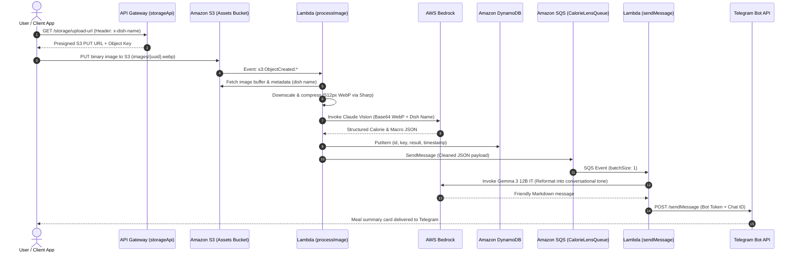

# CalorieLens Backend

[](https://nodejs.org)
[](https://www.serverless.com)
[](https://aws.amazon.com/bedrock/)
[](https://aws.amazon.com/s3/)
[](https://aws.amazon.com/dynamodb/)
[](https://aws.amazon.com/sqs/)
[](https://github.com/masanthimanshu/calorie-lens-backend/actions/workflows/check-code.yaml)
[](https://opensource.org/licenses/ISC)

> An event-driven, production-grade serverless backend powered by AWS Bedrock multimodal AI. It automates dietary logging by analyzing meal photos, estimating calorie and macronutrient breakdowns, storing meal history in Amazon DynamoDB, and delivering formatted nutritional summaries directly to Telegram via Amazon SQS.

---

## Table of Contents

- [What the Project Does](#what-the-project-does)
- [Why the Project is Useful](#why-the-project-is-useful)
- [System Architecture](#system-architecture)
  - [Architecture Topology](#architecture-topology)
  - [End-to-End Processing Sequence](#end-to-end-processing-sequence)
  - [Serverless Lambda Functions](#serverless-lambda-functions)
- [Data Models & Payloads](#data-models--payloads)
  - [Image Upload & S3 Metadata](#image-upload--s3-metadata)
  - [Vision Extraction Schema (Claude)](#vision-extraction-schema-claude)
  - [DynamoDB Storage Model](#dynamodb-storage-model)
  - [Conversational Output (Gemma Telegram Message)](#conversational-output-gemma-telegram-message)
- [Repository Structure](#repository-structure)
- [How Users Can Get Started](#how-users-can-get-started)
  - [Prerequisites](#prerequisites)
  - [1. Clone and Install](#1-clone-and-install)
  - [2. Environment Configuration](#2-environment-configuration)
  - [3. Configure AWS SSM Parameters](#3-configure-aws-ssm-parameters)
  - [4. Local Development](#4-local-development)
  - [5. Code Quality & Linting](#5-code-quality--linting)
  - [6. Deployment](#6-deployment)
- [Usage & API Walkthrough](#usage--api-walkthrough)
  - [Step 1: Health Check](#step-1-health-check)
  - [Step 2: Request Upload Presigned URL](#step-2-request-upload-presigned-url)
  - [Step 3: Upload Meal Image to S3](#step-3-upload-meal-image-to-s3)
  - [Step 4: Automated Background Execution](#step-4-automated-background-execution)
- [Resilience, Observability & Security](#resilience-observability--security)
  - [Resilience & SQS Dead Letter Queue](#resilience--sqs-dead-letter-queue)
  - [Storage Lifecycle Optimization](#storage-lifecycle-optimization)
  - [Structured CloudWatch Logging](#structured-cloudwatch-logging)
  - [Least-Privilege IAM Security](#least-privilege-iam-security)
- [Where Users Can Get Help](#where-users-can-get-help)
- [Who Maintains and Contributes](#who-maintains-and-contributes)
- [License](#license)

---

## What the Project Does

**CalorieLens Backend** solves the friction of traditional dietary logging. Instead of manually searching food databases, measuring portion gram weights, and logging individual ingredients, users capture a photo of their plate.

The backend orchestrates a completely decoupled, event-driven serverless pipeline:

1. **Presigned Direct Ingestion**: Clients request short-lived presigned S3 upload URLs with custom dish metadata headers, uploading heavy image binaries straight to Amazon S3 without saturating API Gateway bandwidth or hitting execution timeouts.
2. **Event-Driven Computer Vision**: An S3 object-creation event triggers an image-processing Lambda worker that compresses and resizes the meal photo using Sharp and invokes Anthropic Claude via AWS Bedrock to identify ingredients, portion sizes, calories, and macronutrients.
3. **Persistent Record Keeping**: Extracted nutritional breakdown data and meal metadata are stored in Amazon DynamoDB for historical tracking and queries.
4. **Resilient Message Queuing**: The analysis result is enqueued onto an Amazon SQS queue backed by an automated 3-retry Dead Letter Queue (DLQ) to protect against downstream rate limits and isolate notification latency.
5. **Conversational Synthesis & Delivery**: An SQS-triggered worker invokes Google Gemma (`google.gemma-3-12b-it`) on AWS Bedrock to transform technical JSON data into an encouraging, beautifully formatted Markdown message, which is delivered instantly to the user's Telegram chat.

---

## Why the Project is Useful

- **100% Serverless & Zero Idle Cost**: Built on AWS Lambda, Amazon S3, Amazon DynamoDB (Pay-Per-Request), Amazon SQS, and API Gateway HTTP API. If no meals are uploaded, resource costs remain near zero.
- **Dual-Model Generative AI Pipeline**:
  - **Vision Extractor (Anthropic Claude via Bedrock)**: Extracts granular nutritional data, macronutrient splits (protein, carbohydrates, fats), and total calorie counts from dish photos and contextual dish names.
  - **Conversational Synthesizer (Google Gemma 3 12B IT via Bedrock)**: Re-articulates structured data into approachable, human-like summaries tailored for mobile chat.
- **Zero API Gateway Payload Bottlenecks**: By delegating photo uploads to presigned S3 URLs, client requests bypass API Gateway's 10 MB payload ceiling and Lambda memory overhead for binary transfers.
- **Optimized Image Processing Pipeline**: Raw images are downscaled to 512px WebP at 75% quality using Sharp before base64 encoding, reducing payload sizes by ~85%, trimming Bedrock token usage, and slashing inference latency.
- **Built-in Asynchronous Fault Tolerance**: Notification dispatching is separated from inference by Amazon SQS (`CalorieLensQueue`) and a Dead Letter Queue (`CalorieLensDeadLetterQueue`, 3 retries), ensuring third-party API spikes (e.g., Telegram rate limits) never cause data loss.
- **Automated S3 Storage Lifecycle**: S3 lifecycle rules automatically transition meal assets to `GLACIER_IR` (Glacier Instant Retrieval) after 10 days and permanently expire them after 100 days, preventing runaway storage costs.
- **Centralized Parameter Management**: Model ARNs, prompt templates, and Telegram bot secrets are stored dynamically in AWS Systems Manager (SSM) Parameter Store, enabling runtime configuration changes without redeploying code.

---

## System Architecture

### Architecture Topology

```mermaid
flowchart TD
    subgraph Client ["Client Interface"]
        User["User / Mobile Client"]
        Telegram["Telegram Messenger"]
    end

    subgraph Ingestion ["Ingestion Layer"]
        APIGW["API Gateway HTTP API (/storage/*)"]
        StorageLambda["Lambda: storageApi (Express.js)"]
        S3["Amazon S3 Bucket (calorie-lens-assets-bucket)"]
    end

    subgraph Processing ["Processing & Inference Layer"]
        ProcessLambda["Lambda: processImage"]
        Sharp["Sharp Image Optimizer (512px WebP)"]
        BedrockClaude["AWS Bedrock (Anthropic Claude Vision)"]
        DDB[("Amazon DynamoDB (calorie-lens-data-table)")]
    end

    subgraph Messaging ["Messaging & Notification Layer"]
        SQS["Amazon SQS (CalorieLensQueue)"]
        DLQ["Amazon SQS DLQ (CalorieLensDeadLetterQueue)"]
        NotifyLambda["Lambda: sendMessage"]
        BedrockGemma["AWS Bedrock (Google Gemma 3 12B IT)"]
    end

    subgraph ConfigLogs ["Config & Observability"]
        SSM["AWS SSM Parameter Store"]
        CloudWatch["Amazon CloudWatch Logs"]
    end

    %% Ingestion flow
    User -->|1. GET /storage/upload-url| APIGW
    APIGW --> StorageLambda
    StorageLambda -->|Generate Presigned PUT URL| User
    User -->|2. PUT /images/{uuid}.webp| S3

    %% Event Processing
    S3 -->|3. s3:ObjectCreated:*| ProcessLambda
    ProcessLambda --> Sharp
    ProcessLambda -->|4. Base64 + Dish Name| BedrockClaude
    BedrockClaude -->|Nutritional JSON| ProcessLambda
    ProcessLambda -->|5. Store Result| DDB
    ProcessLambda -->|6. Enqueue Analysis| SQS
    SQS -.->|Max 3 Retries Exceeded| DLQ

    %% Notification flow
    SQS -->|7. SQS Message Event| NotifyLambda
    NotifyLambda -->|8. Friendly Formatting Prompt| BedrockGemma
    BedrockGemma -->|Formatted Markdown| NotifyLambda
    NotifyLambda -->|9. Telegram Bot API POST| Telegram
    Telegram -->|Instant Notification| User

    %% Config & Observability
    SSM -.->|Model ARN & System Prompt| ProcessLambda
    SSM -.->|Bot Token & Chat ID| NotifyLambda
    StorageLambda -.-> CloudWatch
    ProcessLambda -.-> CloudWatch
    NotifyLambda -.-> CloudWatch
```

### End-to-End Processing Sequence



### Serverless Lambda Functions

| Function Name  | Handler Path                       | Trigger Event                              | Timeout / Concurrency | Core Responsibilities                                                        |
| :------------- | :--------------------------------- | :----------------------------------------- | :-------------------- | :--------------------------------------------------------------------------- |
| `storageApi`   | `src/storage/handler.handler`      | HTTP API (`/storage/{proxy+}`, `ANY`)      | Default Serverless    | Exposes health check and generates secure presigned S3 upload/view URLs.     |
| `processImage` | `src/processImage/handler.handler` | S3 `s3:ObjectCreated:*` (prefix `images/`) | Lambda Default        | Fetches image, optimizes with Sharp, calls Claude Vision, writes DDB & SQS.  |
| `sendMessage`  | `src/sendMessage/handler.handler`  | SQS `CalorieLensQueue` (`batchSize: 1`)    | Lambda Default        | Consumes analysis messages, formats text with Gemma, dispatches to Telegram. |

---

## Data Models & Payloads

### Image Upload & S3 Metadata

When generating a presigned URL via `GET /storage/upload-url`, client applications can provide an optional `x-dish-name` header. The backend assigns this to S3 object metadata:

```http
PUT /images/b48a4d46-1f6e-4ab4-8e1e-fbbe1d78278f.webp HTTP/1.1
Host: calorie-lens-assets-bucket.s3.ap-south-1.amazonaws.com
Content-Type: image/webp
x-amz-meta-dish: Mediterranean Grilled Chicken Salad
```

### Vision Extraction Schema (Claude)

Anthropic Claude analyzes the image and dish name according to the system prompt in AWS SSM, returning a clean JSON schema:

```json
{
  "dish": "Mediterranean Grilled Chicken Salad",
  "total_calories": 485,
  "macronutrients": {
    "protein_g": 42,
    "carbohydrates_g": 18,
    "fat_g": 25
  },
  "ingredients": [
    { "name": "Grilled Chicken Breast", "portion": "180g", "calories": 290 },
    { "name": "Mixed Greens & Tomatoes", "portion": "150g", "calories": 45 },
    { "name": "Feta Cheese & Olives", "portion": "40g", "calories": 90 },
    { "name": "Olive Oil Vinaigrette", "portion": "15ml", "calories": 60 }
  ],
  "confidence_score": 0.92
}
```

### DynamoDB Storage Model

Records are written to the `calorie-lens-data-table` using the AWS SDK Document Client with duplicate-prevention condition expressions:

| Attribute   | Type   | Description                                                             |
| :---------- | :----- | :---------------------------------------------------------------------- |
| `id`        | String | Primary Hash Key (UUIDv4)                                               |
| `key`       | String | S3 object key (e.g. `images/b48a4d46-1f6e-4ab4-8e1e-fbbe1d78278f.webp`) |
| `result`    | String | Cleaned JSON string of the nutritional analysis from Claude             |
| `timestamp` | String | ISO-8601 creation timestamp (e.g. `2026-11-13T12:00:00.000Z`)           |

### Conversational Output (Gemma Telegram Message)

Google Gemma 3 12B IT transforms the raw JSON into an encouraging Telegram notification:

```markdown
🥗 _Nutritional Breakdown: Mediterranean Grilled Chicken Salad_

🔥 _Total Energy:_ ~485 kcal

📊 _Macronutrients:_
• 💪 _Protein:_ 42g
• 🍞 _Carbohydrates:_ 18g
• 🥑 _Fats:_ 25g

🥗 _Key Components:_
• Grilled Chicken Breast (180g) – 290 kcal
• Mixed Greens & Veggies – 45 kcal
• Feta Cheese & Olives – 90 kcal
• Olive Oil Dressing – 60 kcal

_Coach Note:_ Excellent lean protein choice with healthy fats from olive oil! Keep up the balanced eating! 🌟
```

---

## Repository Structure

```text
calorie-lens-backend/
├── .github/
│   └── workflows/
│       ├── check-code.yaml          # CI: Runs Prettier & ESLint checks on main push/PR
│       └── deploy-serverless.yaml   # CD: Deploys stack to AWS via GitHub Actions & OIDC
├── aws/
│   ├── iam.yaml                     # Granular least-privilege IAM policies for Lambda
│   └── resources.yaml               # CloudFormation templates for DynamoDB, S3 & SQS (DLQ)
├── core/
│   ├── bedrock_client.js            # Amazon Bedrock client (Claude Vision + Gemma text)
│   ├── cloudwatch_logs.js           # Structured JSON logger (INFO/ERROR with metadata)
│   ├── dynamo_client.js             # DynamoDB DocumentClient wrapper with safe writes
│   ├── parameter_store.js           # AWS SSM Parameter Store client
│   ├── s3_client.js                 # S3 presigner (PUT/GET) and stream byte downloader
│   ├── secrets_manager.js           # AWS Secrets Manager client helper
│   └── sqs_client.js                # Amazon SQS message publisher
├── src/
│   ├── processImage/                # S3 event-driven Lambda function
│   │   ├── handler.js               # S3 event handler orchestrating analysis, DDB & SQS
│   │   └── service.js               # Image downloader, Sharp optimizer, and Claude caller
│   ├── sendMessage/                 # SQS event-driven Lambda function
│   │   ├── handler.js               # SQS batch consumer
│   │   └── service.js               # Gemma formatter and Telegram Bot API dispatcher
│   └── storage/                     # Express-based HTTP API Lambda function
│       ├── handler.js               # serverless-http wrapper around Express application
│       └── routes.js                # Route definitions (/health, /upload-url)
├── utils/
│   ├── clean_json.js                # Strips markdown backticks and regex-extracts JSON
│   ├── create_app.js                # Express app factory with JSON middleware
│   └── optimize_image.js            # Sharp compressor (width: 512px, WebP quality: 75)
├── eslint.config.js                 # Modern ESLint flat configuration
├── package.json                     # Project manifest, dependencies, and subpath imports
└── serverless.yaml                  # Serverless Framework v4 service & function config
```

---

## How Users Can Get Started

### Prerequisites

- **Node.js**: `v24.x` or higher
- **npm**: `v10.x` or higher
- **AWS CLI**: Installed and configured (`aws configure`) with credentials for AWS Region `ap-south-1`
- **AWS Bedrock Model Access**: Access granted in the AWS Bedrock console for:
  - Anthropic Claude Multimodal model (e.g. `anthropic.claude-3-sonnet-20240229-v1:0` or Bedrock inference profile)
  - Google Gemma 3 (`google.gemma-3-12b-it`)
- **Telegram Bot**:
  - Bot token obtained from [@BotFather](https://t.me/botfather)
  - Your personal or channel `chat_id` (obtained via `@userinfobot` or Telegram API)

### 1. Clone and Install

```bash
git clone https://github.com/masanthimanshu/calorie-lens-backend.git
cd calorie-lens-backend
npm install
```

### 2. Environment Configuration

Create a `.env` file in the project root to set your local AWS CLI profile (if using named profiles):

```env
AWS_PROFILE=your-aws-profile-name
```

The application automatically reads the remaining environment variables configured in `serverless.yaml`:

| Variable             | Value                         | Injected By        |
| :------------------- | :---------------------------- | :----------------- |
| `CURRENT_AWS_REGION` | `ap-south-1`                  | `serverless.yaml`  |
| `TABLE_NAME`         | `calorie-lens-data-table`     | `serverless.yaml`  |
| `BUCKET_NAME`        | `calorie-lens-assets-bucket`  | `serverless.yaml`  |
| `QUEUE_URL`          | `Ref: CalorieLensQueue` (URL) | CloudFormation Ref |

### 3. Configure AWS SSM Parameters

The service dynamically queries configuration from AWS Systems Manager Parameter Store. Create the following parameters in AWS region `ap-south-1`:

| Parameter Name                       | Type           | Description                                                 | Example Value                                                  |
| :----------------------------------- | :------------- | :---------------------------------------------------------- | :------------------------------------------------------------- |
| `/calorie-lens/telegram/bot-token`   | `SecureString` | Telegram Bot token for authentication                       | `7123456789:ABCdefGhIJKlmNoPQRsTUVwxyZ1234567`                 |
| `/calorie-lens/telegram/chat-id`     | `String`       | Target Telegram chat ID where summaries will be delivered   | `987654321`                                                    |
| `/ai/claude-model-arn`               | `String`       | Bedrock Model ID or cross-region inference profile ARN      | `anthropic.claude-3-sonnet-20240229-v1:0`                      |
| `/calorie-lens/lambda/system-prompt` | `String`       | System instructions enforcing the calorie/macro JSON output | `Analyze the meal and return strict JSON with calories/macros` |

Run these commands using the AWS CLI:

```bash
aws ssm put-parameter \
  --name "/calorie-lens/telegram/bot-token" \
  --value "YOUR_TELEGRAM_BOT_TOKEN" \
  --type "SecureString" \
  --region ap-south-1

aws ssm put-parameter \
  --name "/calorie-lens/telegram/chat-id" \
  --value "YOUR_TELEGRAM_CHAT_ID" \
  --type "String" \
  --region ap-south-1

aws ssm put-parameter \
  --name "/ai/claude-model-arn" \
  --value "anthropic.claude-3-sonnet-20240229-v1:0" \
  --type "String" \
  --region ap-south-1

aws ssm put-parameter \
  --name "/calorie-lens/lambda/system-prompt" \
  --value "You are a professional nutritionist. Analyze the dish photo and name provided, and return a strict JSON object containing total_calories, macronutrients (protein, carbs, fat in grams), and an ingredient breakdown with approximate portions." \
  --type "String" \
  --region ap-south-1
```

### 4. Local Development

Start the local API emulator using `serverless-offline`:

```bash
npm run dev
```

The HTTP API is now available locally at `http://localhost:3000`.

> [!NOTE]
> `serverless-offline` simulates the HTTP API layer (`storageApi`). Asynchronous S3 events and SQS queue processing are triggered in AWS or can be invoked locally via AWS CLI Lambda invoke commands.

### 5. Code Quality & Linting

Verify syntax, styling, and formatting:

```bash
# Check code formatting with Prettier
npx prettier --check .

# Automatically apply formatting
npx prettier --write .

# Run ESLint static analysis
npx eslint .
```

### 6. Deployment

#### Manual CLI Deployment

Deploy the entire serverless architecture (S3 bucket, DynamoDB table, SQS queue with DLQ, IAM roles, and Lambda functions) to AWS:

```bash
npm run deploy
```

#### Automated CI/CD (GitHub Actions)

The repository includes preconfigured GitHub Actions workflows in [.github/workflows/](.github/workflows/):

- [.github/workflows/check-code.yaml](.github/workflows/check-code.yaml): Runs on every push and pull request to `main`, validating Prettier formatting and ESLint rules.
- [.github/workflows/deploy-serverless.yaml](.github/workflows/deploy-serverless.yaml): Triggers automatically when `Check Code` succeeds on `main` to deploy to AWS using OpenID Connect (OIDC).

Configure the following GitHub repository secrets (**Settings > Secrets and variables > Actions**):

- `AWS_ROLE`: The ARN of your AWS IAM role configured with GitHub OIDC trust.
- `SERVERLESS_ACCESS_KEY`: Serverless Framework access key for authentication.

---

## Usage & API Walkthrough

### Step 1: Health Check

Verify the HTTP gateway is active:

```bash
curl -X GET "https://<api-id>.execute-api.ap-south-1.amazonaws.com/storage/health"
```

**Response (`200 OK`)**:

```json
{
  "status": "Storage API route is working!"
}
```

### Step 2: Request Upload Presigned URL

Request a secure, short-lived presigned upload URL (valid for 300 seconds). Pass the meal name in the `x-dish-name` header:

```bash
curl -X GET "https://<api-id>.execute-api.ap-south-1.amazonaws.com/storage/upload-url" \
  -H "x-dish-name: Grilled Chicken Breast with Quinoa"
```

**Response (`200 OK`)**:

```json
{
  "uploadUrl": "https://calorie-lens-assets-bucket.s3.ap-south-1.amazonaws.com/images/4a7f9c21-5a2b-4cd3-8e99-1b2c3d4e5f6a.webp?AWSAccessKeyId=...",
  "key": "images/4a7f9c21-5a2b-4cd3-8e99-1b2c3d4e5f6a.webp"
}
```

### Step 3: Upload Meal Image to S3

Upload your meal image directly to S3 via HTTP `PUT` using the `uploadUrl` provided in Step 2:

```bash
curl -X PUT "<uploadUrl>" \
  -H "Content-Type: image/webp" \
  --data-binary "@/path/to/my-meal.webp"
```

### Step 4: Automated Background Execution

Once the `PUT` request finishes:

1. **S3 Event**: S3 emits `s3:ObjectCreated:*` for `images/4a7f9c21-5a2b-4cd3-8e99-1b2c3d4e5f6a.webp`.
2. **Lambda `processImage`**: Downloads the image buffer, downscales to 512px WebP, invokes Claude via Bedrock, saves results to DynamoDB, and posts the JSON payload to SQS.
3. **Lambda `sendMessage`**: Consumes the SQS message, prompts Gemma to create an engaging summary, and delivers the message to your Telegram chat.

---

## Resilience, Observability & Security

### Resilience & SQS Dead Letter Queue

To guarantee message durability and prevent unhandled downstream exceptions (e.g. Telegram API outages or rate limits) from causing data loss:

- The main queue `calorie-lens-queue` is paired with `calorie-lens-dead-letter-queue`.
- The redrive policy allows `maxReceiveCount: 3`. If a message fails processing three times consecutively, SQS automatically routes it to the Dead Letter Queue for inspection and re-driving.

```yaml
CalorieLensQueue:
  Type: AWS::SQS::Queue
  Properties:
    QueueName: calorie-lens-queue
    RedrivePolicy:
      deadLetterTargetArn:
        Fn::GetAtt:
          - CalorieLensDeadLetterQueue
          - Arn
      maxReceiveCount: 3
```

### Storage Lifecycle Optimization

The S3 bucket enforces an automated lifecycle configuration defined in [aws/resources.yaml](aws/resources.yaml):

- **Transition**: Images transition to `GLACIER_IR` (Glacier Instant Retrieval) after **10 days**.
- **Expiration**: Assets are automatically deleted after **100 days**.
- **Multipart Cleanup**: Incomplete multipart uploads are aborted and cleaned up after **5 days**.

### Structured CloudWatch Logging

All application components write structured JSON logs via [core/cloudwatch_logs.js](core/cloudwatch_logs.js):

```json
{
  "key": "images/4a7f9c21-5a2b-4cd3-8e99-1b2c3d4e5f6a.webp",
  "time": "2026-11-13T12:05:30.123Z",
  "message": "Image processed successfully:",
  "level": "✅ INFO"
}
```

CloudWatch Insights query to monitor image processing activity:

```sql
fields @timestamp, message, key, error
| filter level = "❎ ERROR" or level = "✅ INFO"
| sort @timestamp desc
| limit 50
```

### Least-Privilege IAM Security

Lambda functions assume an IAM role scoped strictly to required resources in [aws/iam.yaml](aws/iam.yaml):

- `bedrock:InvokeModel` / `bedrock:InvokeModelWithResponseStream` for AI inference.
- `ssm:GetParameter` / `ssm:GetParameters` for reading dynamic config.
- `dynamodb:*` restricted strictly to `CalorieLensDataTable`.
- `s3:PutObject` / `s3:GetObject` restricted strictly to `calorie-lens-assets-bucket/*`.
- `sqs:SendMessage` / `sqs:ReceiveMessage` / `sqs:DeleteMessage` scoped to `CalorieLensQueue` and `CalorieLensDeadLetterQueue`.

---

## Where Users Can Get Help

- **Issue Tracker**: Submit bugs or feature proposals via [GitHub Issues](https://github.com/masanthimanshu/calorie-lens-backend/issues).
- **Serverless Framework Docs**: Read the [Serverless v4 Guide](https://www.serverless.com/framework/docs).
- **AWS Bedrock Documentation**: Explore foundational models in the [AWS Bedrock Developer Guide](https://docs.aws.amazon.com/bedrock/).
- **Telegram Bot API**: Learn about message formatting in the [Telegram Bot API Reference](https://core.telegram.org/bots/api).

---

## Who Maintains and Contributes

### Maintainer

- **Himanshu Masanth** ([@masanthimanshu](https://github.com/masanthimanshu))

### Contributing

Contributions and improvements are warmly welcome!

1. Fork the repository.
2. Create a feature branch (`git checkout -b feature/amazing-feature`).
3. Ensure formatting and linting pass (`npx prettier --check .` and `npx eslint .`).
4. Commit your changes (`git commit -m "feat: add micronutrient estimation"`).
5. Push to your branch and open a Pull Request against `main`.

---

## License

This project is licensed under the [ISC License](https://opensource.org/licenses/ISC).
